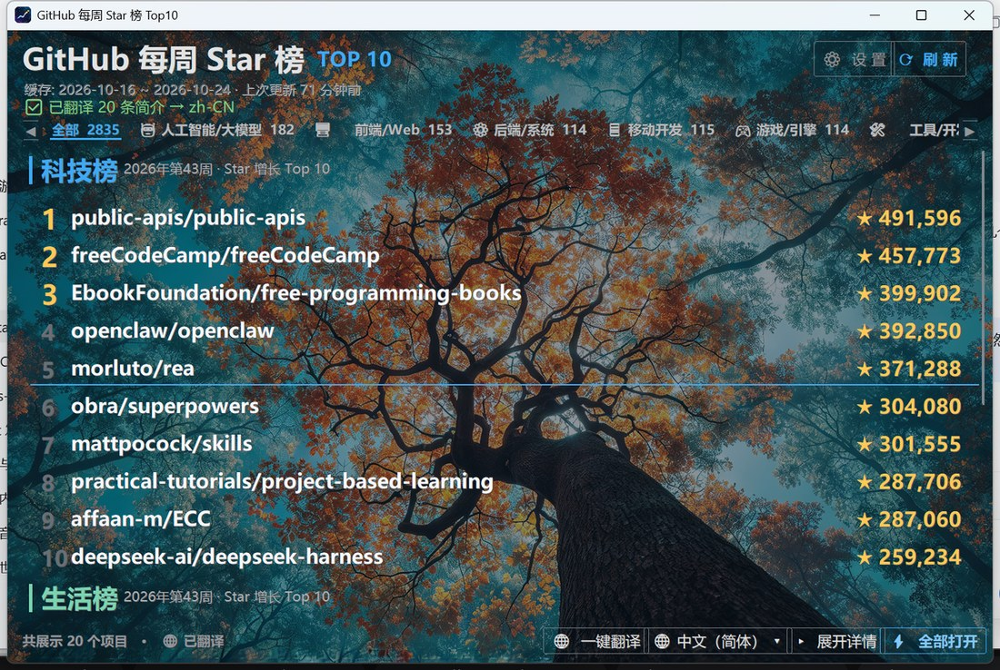
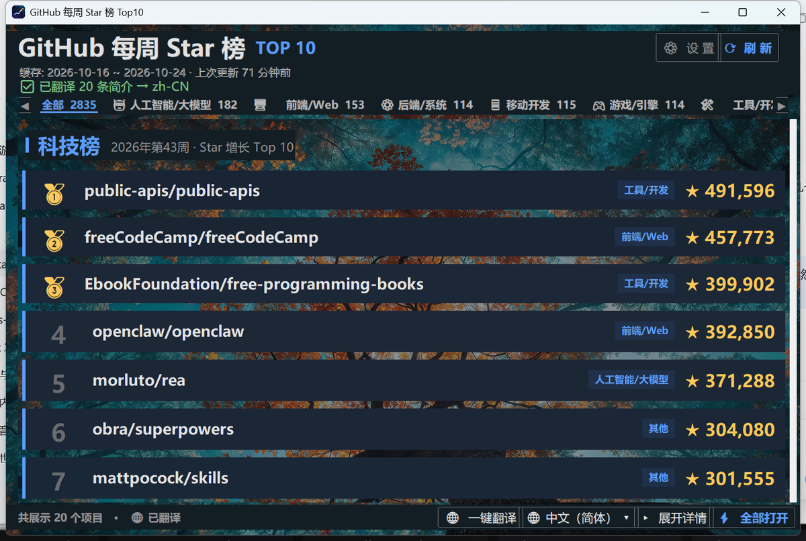
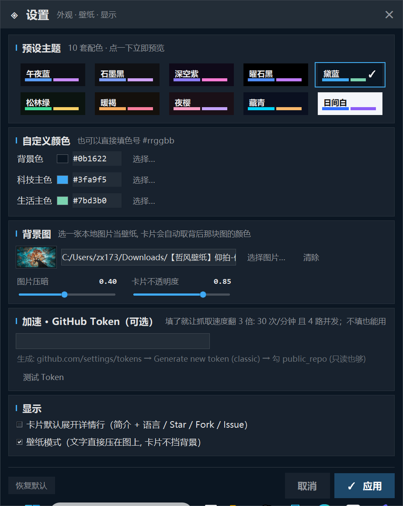

<div align="center">


# GitHub Weekly Star Top10 · GitHub 每周 Star 榜

**每天自动抓取 GitHub 上本周 Star 增长最快的开源项目，按科技 / 生活两大类共 22 个细分领域分类，点一下直接跳浏览器。**

*A lightweight Windows desktop app that ranks the fastest-growing GitHub repositories of the week — sorted into 22 categories across Tech & Life. Click any row to open the repo in your browser.*

[](https://www.python.org/)
[](https://docs.python.org/3/library/tkinter.html)
[](#)
[](LICENSE)
[](https://docs.github.com/rest/search)

[简体中文](#-功能特性) · [English](#-features) · [下载 / Download](#-快速开始--quick-start) · [构建 / Build](#-从源码构建--build-from-source)

</div>



---

## ✨ 功能特性

- **每日自动更新** — 每天只抓一次榜单，之后启动秒开；也可以随时点「⟳ 刷新」手动更新。
- **22 个细分领域** — 不是笼统的「科技 / 生活」两块：人工智能 / 前端 Web / 后端系统 / 移动开发 / 游戏引擎 / 工具开发 / 硬件嵌入式 / 科学算法 / 安全隐私 / 云原生运维 / 数据库 / 编程语言编译器，加上媒体影音 / 效率笔记 / 设计 / 网络工具 / 学习资源 / 金融理财 / 音乐音频 / 智能家居 / 生活健康 / 阅读文档。
- **顶部筛选条** — 点任意分类立刻只显示该领域，带「全部 N」总览和条数统计。
- **一键翻译** — 13 种语言（简繁中文 / English / 日本語 / 한국어 / Русский / Français / Deutsch / Español / Português / العربية / हिन्दी），只翻你眼前那 20 条，翻译结果落盘缓存，第二次瞬开。
- **10 套主题 + 完全自定义** — 预设色板一键切换，也可以用取色器自定背景色和科技 / 生活两条主色，亮暗自动适配文字对比度。
- **自定义背景图** — 选一张自己的照片当壁纸，可调「图片压暗」和「卡片不透明度」，卡片会取背后那块照片的平均色做毛玻璃底，在壁纸上不挡图又看得清。
- **动画节制但不敷衍** — 启动从小放大、分类选中块滑动、点击反馈闪光、刷新时右上角转圈、设置面板从按钮里「长出来」。
- **点击即跳转** — 单击任意项目行 → 默认浏览器打开项目主页；「⚡ 全部打开」一次性打开当前列表。
- **单文件绿色程序** — 打包后是一个 EXE，不写注册表、不带安装器，删掉文件就卸载干净。

<table>
<tr>
<td width="50%"><br><sub>卡片模式（不启用壁纸）</sub></td>
<td width="50%"><br><sub>设置面板：主题 / 壁纸 / 显示 / Token</sub></td>
</tr>
</table>

---

## 🚀 快速开始 / Quick Start

### 方式一：直接运行 EXE（推荐给普通用户）

1. 到 [Releases](../../releases) 下载最新的 `GHTrendingTop10.exe`。
2. 放到一个**独立目录**（例如 `D:\GHTop10\`）再双击运行 —— 它会在这个目录里写 `settings.json` 和 `trending_cache.json` 作为配置和缓存。
3. 首次启动会先显示缓存（如果有）再后台更新；没有缓存时要等 1~3 分钟抓 22 个分类。

> Windows SmartScreen 可能提示「未知发布者」，因为 EXE 没有购买代码签名证书。点「更多信息 → 仍要运行」即可。

### 方式二：从源码跑

```bash
pip install pillow
python ghtrending.py
```

Python 3.10+ 即可，UI 只用标准库 `tkinter`。

---

## 🛠 从源码构建 / Build from source

```powershell
pip install pillow pyinstaller
.\build.ps1
# 产物: dist\GHTrendingTop10.exe
```

`build.ps1` 做的事：

```powershell
python -m PyInstaller --onefile --windowed --name GHTrendingTop10 `
  -i "assets\icon.ico" --splash "assets\splash.png" ghtrending.py
```

图标和启动闪屏都是脚本生成的（`tools/make_icon.py`、`tools/make_splash.py`），想换风格直接改完重跑。

> ⚠️ `--icon` / `--splash` 请用**绝对路径**或确保工作目录正确，`--specpath` 会把相对路径解析到 build 目录，容易报 `Icon input file not found`。

---

## ⚙️ 配置文件 / Configuration

配置写在 EXE 同目录的 `settings.json`（UTF-8），也可以全部在界面「⚙ 设置」里改：

| 键 | 类型 | 说明 |
| --- | --- | --- |
| `bg` | hex | 背景底色，如 `#0d1017` |
| `tech` | hex | 「科技」主色（含筛选条、链接高亮） |
| `life` | hex | 「生活」主色 |
| `lang` | string | 翻译目标语言，`off` 表示不翻译 |
| `details` | bool | 列表是否显示简介 / 详情行 |
| `bgimg` | string | 背景图路径，空字符串 = 无壁纸 |
| `bgdim` | 0~0.85 | 背景图压暗程度 |
| `cardop` | 0.45~1.0 | 卡片不透明度 |
| `wallmode` | bool | 「壁纸模式」：列表直接画在壁纸上，不用卡片 |
| `token` | string | GitHub Personal Access Token（可选，见下） |
| `win` | string | 记住的窗口位置，如 `1460x940+550+304` |

### 关于 GitHub Token

未认证调用 GitHub Search API 的限额是 **10 次/分钟**，抓 22 个分类会被节流，首次全量更新要 1~3 分钟。填一个**只给 `public_repo` 只读权限**的 token（[生成入口](https://github.com/settings/tokens)）后：

- 限额提到 **30 次/分钟**，并发线程也从 2 提到 4，全量更新通常 30~60 秒；
- 设置面板里有「测试」按钮，会打一次 `/rate_limit` 验证并显示当前额度。

---

## 📊 数据来源与限制 / Data Sources

- 主数据源：GitHub 官方 **Search API**（`sort=stars`、`pushed:>=<一周前>`），按 topic / language 分 22 组查询。
- 缓存策略：分类结果 20 小时内直接复用；首屏只抓 1 页先出内容，剩下分类后台安静补，最多 4 轮 —— 所以你会看到「已更新 12/22 个分类 · 其余后台补」，这是正常的。
- `per_page` 上限 50：要 100 会被链路截断成 `IncompleteRead`，白等几十秒。
- 榜单口径是「**近一周有推送 + Star 总量排序**」的近似周榜，不是严格意义上的「本周新增 Star」；GitHub 没有公开的周增量接口。

---

## 🧭 使用技巧 / Tips

- **双击 / 右键 / 回车** 卡片同样能打开项目；右键还有「复制仓库名」。
- 顶部筛选条可用 **鼠标滚轮横向滚动**，两端 `◀ ▶` 每次挪一个分类。
- 想换壁纸又不挡字：设置里把「图片压暗」调到 0.4~0.6、「卡片不透明度」0.8 左右。
- 启动动画期间不要频繁点，等标题栏出现再操作。

---

## ❓FAQ

**Q：第一次启动很慢？**
没有缓存时要抓 22 个分类，未认证限额下确实要 1~3 分钟。第二次起因为每天只更新一次 + 本地缓存，基本 1 秒内出完整榜单。

**Q：为什么我的周榜数字和别的站不一样？**
口径不同。本项目用「近 7 天有 push + Star 排序 + 分类抽样」，不是全网全量统计。

**Q：EXE 打开报「Could not create temporary directory」？**
PyInstaller 单文件程序需要可写的临时目录。放到普通目录（如 `D:\App\`）运行，别放在受限的工作区 / 只读盘。

**Q：翻译不走代理连不上？**
Google 翻译在部分网络下需要代理。程序会记住每个域名上次成功的通路（直连或系统代理），配置里也能看到效果：第一次慢，之后 2 秒内返回。

---

## 🗺 Roadmap

- [ ] macOS / Linux 打包
- [ ] 严格「本周新增 Star」增量（用快照差分算）
- [ ] 收藏 / 忽略某些仓库
- [ ] 深色 / 浅色跟随系统

欢迎 Issue 和 PR。

---

## 📄 License

[MIT](LICENSE) © The GHTrendingTop10 Authors

---

<div align="center">

## Features

**English**

- **Daily refresh** — one fetch per day, instant startup afterwards; manual refresh available anytime.
- **22 fine-grained categories** — AI/LLM, Frontend/Web, Backend/Systems, Mobile, Game engines, Dev tools, Hardware/Embedded, Science/Algorithms, Security/Privacy, Cloud-native/DevOps, Databases, Languages/Compilers, plus Media, Productivity, Design, Network tools, Learning resources, Finance, Music/Audio, Smart home, Health, Docs/Reading.
- **Filter bar** with live counts, wheel-scrollable, one click to focus a category.
- **One-click translation** into 13 languages (zh-CN/zh-TW/en/ja/ko/ru/fr/de/es/pt/ar/hi), cached on disk after the first run.
- **10 themes + full custom colors + custom wallpaper** with adjustable dimming and card opacity (cards sample the photo behind them for a frosted look).
- **Click to open** any repository in your default browser; "Open all" opens the current list at once.
- **Single-file, portable EXE** — no installer, no registry, no leftovers.

### Requirements

- Windows 10/11, Python 3.10+ (source) — UI is pure `tkinter`, no extra runtime deps besides Pillow.

### Install / Run

```bash
pip install pillow
python ghtrending.py
```

Build a standalone EXE with `build.ps1` (PyInstaller, one file, ~30 MB).

### Data

GitHub Search API (`sort=stars`, `pushed:>=last-week`), 22 grouped queries. Category results are reused for 20 hours; the first page renders immediately and the rest is filled in quietly in the background. Add a GitHub token in Settings to raise the rate limit from 10 to 30 requests/min.

### License

MIT — see [LICENSE](LICENSE).

</div>
